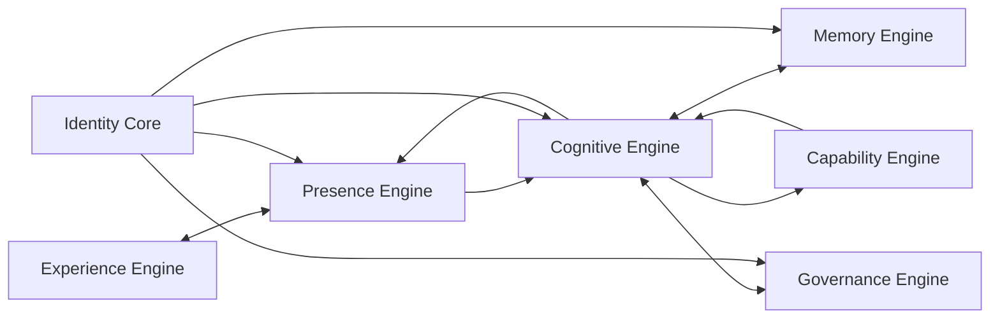

# ARIA — Audit de cohérence documentaire
**Date :** 3 novembre 2026  
**Branche :** `docs/aria-system-blueprint-v1`  
**Périmètre :** cohérence produit, expérience, architecture et statut technique. Lecture seule des sources ; ajout de ce rapport documentaire uniquement.  
**Aucun code, service, secret, migration, déploiement, production ou branche `main` n'a été modifié.

---

## 1. Verdict exécutif

<badge>À corriger avant validation du Blueprint</badge>

Les documents partagent une direction cohérente — ARIA comme assistante personnelle généraliste, vocale, contextuelle, évolutive, dotée d'une autonomie contrôlée — mais le premier System Blueprint V1.0 n'est **pas encore conforme à l'architecture directrice décidée le 3 novembre 2026**.

Le défaut principal est structurel : le Blueprint a inventé une taxonomie de moteurs de premier niveau (Tool Foundry, Creation Engine, World & Simulation Engine, Perception Engine, Research & Discovery, Execution Engine, Evolution Engine) alors que l'architecture directrice retenue repose sur sept systèmes nommés précisément :

1. Identity Core
2. Presence Engine
3. Cognitive Engine
4. Memory Engine
5. Governance Engine
6. Capability Engine
7. Experience Engine

Les concepts Tool Foundry, création, simulation, perception, recherche, exécution et évolution peuvent être des sous-systèmes, familles de capacités ou services du Capability Engine. Ils ne doivent pas remplacer ni concurrencer les sept systèmes directeurs sans décision explicite.

Le Blueprint est donc une proposition de travail utile, mais son diagramme, ses frontières et sa matrice d'autonomie doivent être corrigés avant de devenir une référence d'architecture.

## 2. Sources et statut constaté

| Source | Statut constaté | Autorité / usage |
|---|---|---|
| Décisions utilisateur du 3 novembre 2026 | D-001, D-002 et D-003 validées ; D-004 à D-007 ouvertes selon le registre récupéré | Priorité la plus élevée pour les décisions explicitement confirmées |
| Experience Definition V1.0 | Validée par l'utilisateur le 3 novembre 2026 ; texte canonique non localisé dans le dépôt lors de cet audit | Référence conceptuelle de l'expérience ; complète le Master Specification, ne le remplace pas |
| Master Specification V1.0 | Présent sur `docs/master-specification-aria-v1-0-2026-11-01`, pas sur `main` au contrôle | Consolidation proposée ; son propre chapitre 0 établit une hiérarchie des sources et les statuts de preuve |
| Vision V1.3 / complément V1.2.1 | Présents sur `docs/aria-vision-autonomy-v1-3-final` ; PR #44 ouverte en brouillon | Vision étendue documentée, non fusionnée |
| Feuille de route App Store V1.2 | Présente sur la branche documentaire V1.3 | Ordre de réalisation et critères de sortie, pas preuve de livraison |
| System Blueprint V1.0 | Créé sur `docs/aria-system-blueprint-v1` | Proposition d'architecture à corriger selon le présent audit |
| Audit staging du 29 octobre | PR #45 ouverte en brouillon | État documenté plus récent que l'audit du 22 octobre repris dans le Blueprint |
| Dépôt `main` | Dernier commit observé : 22 octobre 2026 ; PWA V0.7 | Source de vérité du code fusionné, pas de toutes les branches de travail |

### Documents V2.0 non localisés

Les intitulés **Vision stratégique ARIA V2.0** et **Master Architecture V2.0** sont mentionnés dans le contexte de conception du 3 novembre. Leurs versions canoniques complètes n'ont pas été localisées dans les fichiers du dépôt pendant cet audit. Les décisions structurantes connues ont été prises en compte ci-dessous, mais il ne faut pas prétendre avoir comparé mot à mot des documents qui ne sont pas disponibles comme sources versionnées.

**Action P0 :** enregistrer les deux documents V2.0 dans le dépôt ou désigner leurs emplacements canoniques, avec version, date, statut et relation au Master Specification.

## 3. Décisions de conception confirmées

### D-001 — Noyau stable, personnalité et perspectives évolutives
<badge color="success">Validée</badge>

Le noyau stable porte l'identité, le contexte, le raisonnement et l'orchestration. La personnalité, les modes d'expression, les expériences et les capacités peuvent évoluer dans des limites gouvernées. Une évolution de personnalité ou de capacité ne doit pas modifier implicitement l'identité fondamentale, les permissions ou les règles de sécurité.

### D-002 — Mémoire « rich »
<badge color="success">Validée</badge>

La mémoire est riche et multicouche, pas une simple liste de notes. Elle doit distinguer au minimum les souvenirs personnels, préférences, historique, projets, tâches, décisions, connaissances et hypothèses. Les règles d'accès, de conservation, de partage, de provenance, de correction, d'export et de suppression doivent être explicites. Le consentement et l'isolation par compte restent obligatoires.

### D-003 — « Partenaire autonome »
<badge color="success">Validée</badge>

ARIA est conçue comme un partenaire autonome, et non comme un simple exécutant réactif. Cette autonomie est encadrée par des permissions, des limites, des règles de fréquence et des critères vérifiables qui restent à formaliser. L'initiative ne confère jamais de nouvelles permissions. Les actions sensibles restent soumises aux confirmations adaptées au risque.

### D-004 à D-007
<badge color="warning">À arbitrer</badge>

Les décisions détaillées relatives à la personnalité, à l'immersion, au multiplateforme et à la gouvernance des évolutions restent ouvertes dans le registre récupéré. Les exigences déjà explicites du Master Specification et de l'Experience Definition continuent de s'appliquer ; l'absence d'arbitrage D-004 à D-007 ne les annule pas.

## 4. Écarts de cohérence à corriger

| ID | Gravité | Écart | Correction attendue |
|---|---|---|---|
| COH-01 | P0 | Le Blueprint ne reprend pas les sept systèmes directeurs et introduit des moteurs concurrents. | Réécrire le diagramme et la section responsabilités avec Identity Core, Presence, Cognitive, Memory, Governance, Capability et Experience. |
| COH-02 | P0 | Identity & Governance sont fusionnés dans le Blueprint. | Séparer Identity Core (identité stable et contexte d'identité) de Governance Engine (politiques, permissions, approbations, audit et révocation). |
| COH-03 | P0 | Presence Engine absent ; le flux est un pipeline générique UI → Governance → Cognitive. | Représenter la boucle directrice : Presence → Cognitive → Memory/Governance → Capability → Cognitive → Presence ; Experience Engine ↔ Presence Engine. |
| COH-04 | P0 | Le Blueprint transforme des familles de capacités en moteurs racine. | Replacer Tool Foundry, création, simulation, perception, recherche, exécution et évolution comme sous-systèmes ou capacités gouvernés par Capability Engine. |
| COH-05 | P1 | Le caractère « rich » de la mémoire n'est pas assez spécifié par les seuls compartiments techniques. | Définir le modèle sémantique, les droits utilisateur, la provenance, les règles de rétention et le cycle de vie complet. |
| COH-06 | P1 | La matrice A/B/C/D du Blueprint est écrite comme une règle arrêtée, alors que D-003 valide le principe d'un partenaire autonome mais pas encore les seuils. | Marquer la matrice comme proposition ; définir les seuils à partir du risque, de l'impact, de la réversibilité, du coût, de la confiance, de la portée et des permissions préautorisées. |
| COH-07 | P1 | La voix prioritaire, la présence, la relation et l'onboarding sont sous-représentés dans le Blueprint. | Intégrer les exigences de l'Experience Definition et du Master Specification : voix principale, interruption immédiate, états vocaux exacts, transcription facultative, onboarding conversationnel, personnalité complice et HUD discret. |
| COH-08 | P1 | Le Blueprint décrit une hybridation local/cloud générique sans contrat explicite des clients iPhone, Web et PC. | Définir les rôles de chaque client, le plan de synchronisation, l'état hors ligne, les conflits et les limites réelles des plateformes. |
| COH-09 | P1 | Le Blueprint reprend l'audit staging du 22 octobre alors que le Master Specification du 1er novembre et la PR #45 contiennent des éléments plus récents. | Réviser la cartographie technique à partir des preuves datées du 1er novembre et signaler ce qui n'a pas été revalidé depuis. |
| COH-10 | P1 | La hiérarchie documentaire du Master Specification n'est pas reprise explicitement. | Conserver la priorité des décisions utilisateur récentes et le statut distinct des exigences décidées, cibles, visions étendues et preuves d'exécution. |
| COH-11 | P2 | Le Blueprint n'explicite pas assez la frontière entre ambition V2.0 et idées réservées hors périmètre immédiat. | Garder hors périmètre immédiat les concepts réservés dans le Master Specification : OS cognitif général, monde miroir universel, moteur causal général, mondes parallèles et auto-amélioration générale. |
| COH-12 | P2 | Les systèmes et contrats ne sont pas encore reliés à une matrice de traçabilité par exigence. | Chaque exigence doit pointer vers un système propriétaire, un contrat, des tests, une preuve et un statut. |

## 5. Architecture directrice à retenir

Le modèle directeur est composé de sept systèmes, avec frontières explicites.

| Système | Responsabilité de référence |
|---|---|
| **Identity Core** | Identité stable d'ARIA et contexte d'identité utilisateur authentifié ; séparation des comptes et espaces. Ne décide pas seul des permissions d'action. |
| **Presence Engine** | Présence conversationnelle en temps réel : états, disponibilité, écoute, parole, interruption, reprise et continuité immédiate. |
| **Cognitive Engine** | Compréhension, raisonnement, contexte, intention, planification, arbitrage et orchestration. Il ne contourne jamais Governance. |
| **Memory Engine** | Mémoire riche multicouche, historique, souvenirs, préférences, projets, tâches et décisions, avec provenance et cycle de vie contrôlé. |
| **Governance Engine** | Permissions, politiques, consentement, niveaux de risque, approbations, quotas, audit, révocation et limites d'autonomie. |
| **Capability Engine** | Registre et exécution des capacités : outils, connecteurs, création, recherche, perception, simulation, automatisation et évolution contrôlée. |
| **Experience Engine** | Expérience utilisateur et expression : personnalité, profils, voix, HUD, visualisations, immersion, clients et adaptation contextuelle. |

### Relations de référence

Cette représentation reprend la boucle de conception validée. Les appels de contrôle de Governance et les lectures/écritures Memory doivent être appliqués selon les contrats et politiques appropriés. Le diagramme ne signifie pas que tous les échanges sont synchrones.

### Placement des sous-systèmes

- Tool Foundry : sous-système de création et de maintenance de capacités au sein de Capability Engine.
- Creation Engine : famille de capacités de création, pas un moteur racine supplémentaire à ce stade.
- World & Simulation : capacités de modélisation et de simulation, avec solveurs et validations spécialisés.
- Perception : capacités d'entrée multimodale, soumises aux permissions de capture.
- Research & Discovery : capacités de recherche et d'expérimentation avec provenance et validation.
- Execution : runtime et protocole d'exécution des capacités.
- Evolution : processus gouverné de proposition, test, évaluation, déploiement autorisé et retour arrière ; ne peut pas modifier les politiques qui le contrôlent.
- Knowledge : fonction transversale de recherche, provenance et qualité de l'information, articulée avec Cognitive et Memory ; pas nécessairement un huitième moteur.

## 6. Alignement produit et expérience

Le Blueprint doit être explicitement compatible avec les exigences déjà documentées :

- ARIA est une assistante personnelle généraliste, pas un simple chatbot.
- La voix est le canal principal ; le texte reste un secours et un support de consultation.
- L'écoute n'est jamais cachée ; microphone et états réels doivent être compréhensibles.
- L'utilisateur peut interrompre immédiatement ARIA, arrêter ou mettre en pause l'écoute.
- L'orbe exprime les états réels et n'est pas un bouton de commande.
- Le HUD est borderless, discret, chaleureux, minimaliste et contextuel.
- L'onboarding est conversationnel et recueille séparément les préférences et le consentement mémoire.
- La personnalité est élégante, vive, complice et naturellement humoristique ; ARIA tutoie son utilisateur.
- Le logo A triangulaire peut servir de seuil vers les visualisations immersives et permettre le retour sans perte de contexte.
- Les visualisations distinguent rendu visuel, modèle manipulable, simulation, données simulées et données réelles.
- iPhone, Web et PC doivent former un écosystème cohérent, sans supposer qu'une API navigateur offre les mêmes permissions qu'un client natif.

## 7. Audit de l'état technique et de la traçabilité

### 7.1 Code fusionné
Le README et le code de `main` inspectés décrivent la base PWA V0.7 : interface, historique et mémoire locale ; le vrai modèle IA, l'authentification utilisateur, la synchronisation iPhone-PC et les actions Windows n'y sont pas intégrés. Le dernier commit observé de `main` date du 22 octobre 2026.

### 7.2 Branches de travail
Le dépôt contient de nombreuses branches et PR spécialisées : HUD vocal, onboarding, authentification, mémoire, autorisation D1, tests HTTP multi-comptes, compagnon Windows, visualisations, finance et science. Leur présence ne vaut pas intégration. Il faut suivre leurs dépendances et leurs bases de branche avant tout choix d'intégration.

### 7.3 État serveur documenté au 1er novembre
Le Master Specification V1.0 rapporte notamment :
- Worker staging toujours sur la version 26 documentée, avec mode `session_kv` ;
- présence de `ARIA_REQUIRE_INDIVIDUAL_AUTH=true`, mais garde-fou non encore appliqué à toutes les routes dans le code alors déployé ;
- PR #54 destinée à refuser les modes `session_kv` et `legacy` lorsque l'authentification individuelle est requise, sans être déployée au moment de l'audit ;
- absence de parcours HTTP authentifié de bout en bout avec deux comptes canoniques distincts attesté ;
- mémoire persistante multi-utilisateur non considérée comme validée ;
- migrations D1 versionnées 0001–0003 et structure des tables vérifiées, mais absence de table de suivi des migrations relevée ;
- absence des bindings Supabase Auth attendus à la date de cet audit.

Ces constats sont datés du 1er novembre et documentaires. Ils ne sont pas une nouvelle interrogation runtime effectuée le 3 novembre.

### 7.4 Documents non fusionnés
- Master Specification V1.0 : branche documentaire dédiée, non fusionnée dans `main`.
- Vision V1.3 et complément V1.2.1 : PR #44 ouverte en brouillon.
- Audit staging du 29 octobre : PR #45 ouverte en brouillon.
- Correctif vocal #56 : PR ouverte en brouillon, basée sur une branche d'authentification ; son test sur iPhone physique reste non attesté.
- System Blueprint V1.0 et présent audit : branche documentaire dédiée.

### 7.5 Conséquence
Ne pas décrire ARIA comme un système autonome opérationnel. Le dépôt présente une base fusionnée limitée, des prototypes et des chantiers non fusionnés, ainsi qu'un staging dont les preuves de sécurité et de bout en bout sont encore incomplètes.

## 8. Réconciliation avec la hiérarchie du Master Specification

Le chapitre 0 du Master Specification V1.0 donne une hiérarchie de sources et distingue les décisions, cibles, visions étendues et preuves d'exécution. Cette discipline doit être conservée.

Complément à appliquer à la date du 3 novembre :

1. Une décision utilisateur explicite plus récente prévaut.
2. L'Experience Definition V1.0 est une référence conceptuelle validée qui complète le Master Specification.
3. Les décisions D-001, D-002 et D-003 doivent être intégrées au registre de décisions et aux futurs documents d'architecture.
4. Les documents Vision stratégique V2.0 et Master Architecture V2.0 doivent être versionnés et leur relation de priorité clarifiée.
5. Les capacités décrites dans une vision ou un blueprint ne deviennent jamais « implémentées » sans preuve de code, tests et validation adaptée.

## 9. Ordre de correction recommandé

### P0 — Canonicaliser les références
- localiser et versionner Vision stratégique V2.0 et Master Architecture V2.0 ;
- versionner Experience Definition V1.0 dans le dépôt, sans modifier son contenu validé ;
- confirmer la hiérarchie exacte avec Master Specification V1.0 ;
- enregistrer D-001, D-002 et D-003 comme décisions validées et D-004 à D-007 comme ouvertes.

### P0 — Corriger le System Blueprint
- remplacer la taxonomie de moteurs par les sept systèmes directeurs ;
- séparer Identity Core et Governance Engine ;
- réintroduire Presence Engine et Experience Engine ;
- repositionner les moteurs spécialisés comme sous-systèmes/capacités ;
- rendre la matrice d'autonomie explicitement provisoire jusqu'à validation des seuils.

### P1 — Définir les contrats
- identité et contexte ;
- présence et cycle vocal ;
- contexte cognitif, intention et planification ;
- mémoire riche et consentement ;
- gouvernance, permissions et approbations ;
- manifeste et exécution des capacités ;
- expérience, profils et clients.

### P1 — Produire une matrice de traçabilité
Pour chaque exigence : source, statut, système propriétaire, contrat, données, permission, tests, preuve, dépendances et critères de sortie.

### P1 — Réconcilier le code et les branches
Après validation documentaire seulement, réaliser un audit technique séparé des branches/PR et du staging. Ne pas fusionner les PR empilées sans revue de leur base, de leur ordre et de leurs tests.

## 10. Décision d'audit

**Conclusion : cohérence conceptuelle partielle, cohérence architecturale insuffisante, cohérence d'implémentation non démontrée.**

Le Master Specification V1.0 et l'Experience Definition V1.0 restent les références produit et expérience identifiées. Les décisions D-001 à D-003 précisent désormais la direction architecturale. Le System Blueprint V1.0 doit être révisé pour refléter les sept systèmes directeurs avant toute validation.

**Périmètre de ce travail : documentaire uniquement.** Aucun merge, déploiement, changement de configuration, migration, secret ou service n'a été effectué.

**ARIA — Beyond what exists.**
