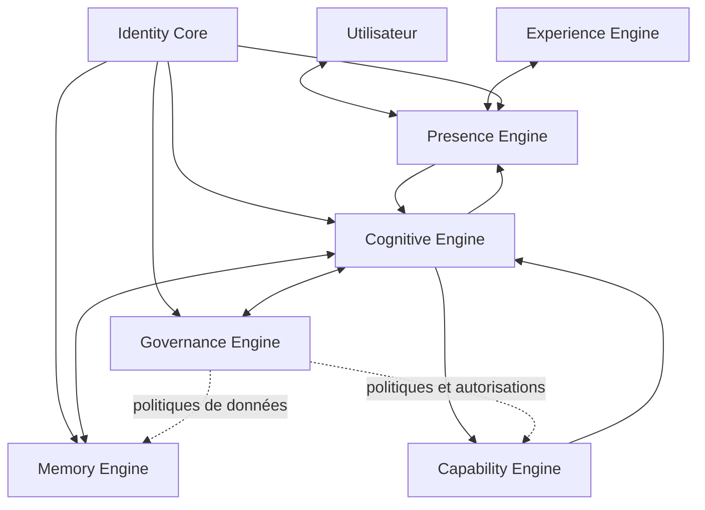

# ARIA — MASTER ARCHITECTURE V2.0
## Architecture de référence — projet de consolidation

**Version :** 2.0 — Draft de travail  
**Date :** 3 novembre 2026  
**Statut :** Proposition architecturale à arbitrer — non canonique  
**Branche :** `architecture/master-architecture-v2-draft`  
**Base documentaire :** Master Specification V1.0, Experience Definition V1.0 validée, décisions D-001 à D-003 et audit de cohérence du 3 novembre 2026.  
**Périmètre :** architecture cible. Ce document ne décrit pas l'état livré et n'autorise aucun déploiement, merge, migration ou changement de production.

> **Limite de source :** les versions complètes et canoniques de « Vision stratégique ARIA V2.0 » et de « Master Architecture V2.0 » n'ont pas été localisées dans le dépôt lors de l'audit. Ce document est donc une proposition de consolidation fondée sur les décisions effectivement récupérées. Il ne prétend pas reproduire ni remplacer un document V2.0 antérieur non consulté.

---

## 0. Positionnement et hiérarchie

Cette architecture précise la structure logique cible d'ARIA. Elle complète les exigences produit et expérience ; elle ne les remplace pas.

Ordre de référence à conserver :
1. décisions explicites de l'utilisateur, en privilégiant les arbitrages les plus récents ;
2. Master Specification V1.0 pour les exigences produit, fonctionnelles, techniques et de sécurité ;
3. Experience Definition V1.0 pour la définition conceptuelle de l'expérience, complémentaire au Master Specification ;
4. décisions d'architecture validées et ADR approuvés ;
5. présente architecture, tant qu'elle demeure en draft ;
6. implémentation et preuves observées, qui déterminent seules ce qui est réellement livré.

Une ambition, un diagramme ou une spécification ne constituent pas une preuve d'implémentation.

### Décisions de conception intégrées

- **D-001 — Validée :** noyau stable, personnalité et perspectives évolutives. L'identité, le contexte, le raisonnement et l'orchestration constituent le socle stable ; personnalité, expression et capacités évoluent sous gouvernance.
- **D-002 — Validée :** mémoire riche et multicouche. Son cycle de vie, ses droits, sa conservation, son partage, sa provenance, sa correction, son export et sa suppression doivent être spécifiés.
- **D-003 — Validée :** ARIA est un partenaire autonome, et non un simple exécutant réactif. L'autonomie reste bornée par des permissions, des limites, des règles de fréquence et des critères à formaliser.

Les décisions D-004 à D-007 (personnalité détaillée, immersion, multiplateforme et gouvernance de l'évolution) sont considérées comme ouvertes dans le registre consulté. Les exigences déjà présentes dans les sources produit et expérience restent applicables.

---

## 1. Principes architecturaux

1. **Un noyau cohérent, sept systèmes directeurs.** Les sept systèmes ont des responsabilités distinctes et coopèrent par contrats explicites.
2. **Identité ≠ autorisation.** Identity Core établit l'identité et le contexte ; Governance Engine décide si une opération est permise.
3. **Présence ≠ interface.** Presence Engine gère la continuité de l'interaction en temps réel ; Experience Engine définit la manière dont cette présence est vécue et exprimée.
4. **Cognition ≠ exécution.** Cognitive Engine comprend, raisonne et planifie ; Capability Engine exécute les capacités autorisées.
5. **Mémoire sous contrôle.** Memory Engine assure une mémoire riche, traçable, compartimentée et gouvernée.
6. **Autonomie sans élévation de privilèges.** L'initiative d'ARIA ne crée jamais une permission supplémentaire.
7. **Voix prioritaire.** La voix est le canal principal de l'expérience ; le texte est un canal secondaire et un moyen de consultation ou de secours.
8. **Hybridation explicite.** Les traitements locaux et cloud sont choisis selon confidentialité, latence, disponibilité, ressources et capacités réelles des plateformes.
9. **Preuve avant affirmation.** Toute capacité doit avoir un statut, des tests, une version et des éléments de preuve.
10. **Évolution réversible.** Les changements passent par une proposition, une branche isolée, une validation, une autorisation adaptée et un retour arrière possible.

---

## 2. Vue d'ensemble — sept systèmes directeurs

La boucle opérationnelle centrale est :

**Presence → Cognitive → Memory / Governance → Capability → Cognitive → Presence**

**Experience Engine ↔ Presence Engine**

Identity Core fournit le contexte d'identité aux systèmes qui en ont besoin. Governance Engine applique les règles d'autorisation aux opérations et aux accès aux données. Les relations du schéma sont logiques : elles ne prescrivent pas que chaque échange soit synchrone.

### Les sept systèmes

| Système | Mission | Frontière non négociable |
|---|---|---|
| **Identity Core** | Identité stable d'ARIA, identité utilisateur authentifiée, comptes, espaces et contexte d'identité | Ne décide pas seul des permissions d'action |
| **Presence Engine** | Présence conversationnelle temps réel, états d'écoute et de parole, interruption, reprise et continuité | Ne simule jamais un état matériel ou vocal qui n'existe pas |
| **Cognitive Engine** | Compréhension, raisonnement, contexte, intention, planification, arbitrage et orchestration | Ne contourne ni Governance ni les contrats de capacités |
| **Memory Engine** | Mémoire riche multicouche, historique, préférences, projets, tâches, décisions et provenance | N'effectue aucun partage ou effacement hors politique et droits |
| **Governance Engine** | Permissions, politiques, consentement, risques, approbations, quotas, audit, révocation et limites d'autonomie | Ne délègue pas la décision d'autorisation au client |
| **Capability Engine** | Registre, découverte, orchestration d'exécution et capacités spécialisées | Une capacité ne peut s'accorder elle-même des privilèges |
| **Experience Engine** | Personnalité, profils, expression, voix, HUD, visualisations, immersion et cohérence des clients | Ne présente pas comme disponible une fonction non prise en charge par la plateforme |

---

## 3. Définition des systèmes

### 3.1 Identity Core

**Responsabilités**
- Maintenir l'identité fondamentale et la continuité d'ARIA.
- Représenter l'utilisateur authentifié, son compte et ses espaces de travail.
- Fournir un contexte d'identité vérifié côté serveur aux systèmes autorisés.
- Garantir la séparation entre comptes, sessions et espaces.
- Distinguer identité d'ARIA, identité de l'utilisateur, identité d'un appareil et identité d'un service.

**Ne relève pas d'Identity Core**
- Décider si ARIA peut envoyer un message, modifier un fichier ou exécuter une tâche.
- Définir seul les consentements et politiques de traitement.
- Stocker des secrets dans un client.

**Contrats attendus**
- `IdentityContext` : sujet authentifié, compte, espace, session, appareil déclaré, niveau d'assurance et horodatage.
- `IdentityStatus` : état de session, expiration et motif de révocation.
- Les identifiants transmis par le client ne sont jamais considérés comme une preuve d'identité.

### 3.2 Presence Engine

**Responsabilités**
- Gérer le cycle de vie d'une interaction : disponibilité, écoute, compréhension en cours, réponse, interruption, pause, reprise et indisponibilité.
- Coordonner capture audio, transcription éventuelle, synthèse vocale et transport temps réel.
- Maintenir la continuité d'une conversation à travers les interruptions et changements de canal.
- Signaler les états réels du microphone, du haut-parleur et des services.

**Contraintes**
- L'utilisateur doit pouvoir interrompre immédiatement la parole et contrôler l'écoute.
- Aucune écoute cachée : les états de capture doivent être explicites.
- L'orbe ou indicateur visuel exprime l'état réel ; il n'est pas présenté comme une commande s'il ne l'est pas.
- La perte réseau, le refus d'autorisation ou l'indisponibilité audio doivent produire un état explicite.

**Contrats attendus**
- `PresenceState` : état, canal, horodatage, source et disponibilité.
- `TurnEvent` : début, segment, fin, interruption ou annulation d'un tour.
- `AudioCapabilityReport` : capacités réelles de l'appareil et permissions accordées.

### 3.3 Cognitive Engine

**Responsabilités**
- Comprendre l'intention et les contraintes.
- Maintenir le contexte conversationnel pertinent.
- Distinguer faits, hypothèses, incertitudes et préférences.
- Décomposer les objectifs en plans et tâches.
- Sélectionner les capacités pertinentes dans le registre.
- Évaluer les résultats, demander une correction bornée ou expliquer un blocage.
- Adapter l'initiative au contexte sans dépasser les permissions.

**Sous-composants logiques possibles**
- Intent & Context Resolver.
- Reasoning & Planning.
- Decision / Arbitration.
- Capability Planner.
- Result Evaluator.

Ces composants sont des frontières internes proposées, pas des services autonomes obligatoires.

**Contraintes**
- Ne jamais traiter une sortie de modèle comme une autorisation.
- Ne jamais annoncer une action réussie avant retour de confirmation.
- Présenter l'incertitude lorsque les preuves sont insuffisantes.
- Transmettre les actions à Capability Engine après contrôle Governance.

### 3.4 Memory Engine

**Objectif :** fournir une mémoire riche et utile, sans devenir un stockage indifférencié.

**Familles de mémoire**
- Mémoire personnelle : éléments explicitement destinés à la continuité personnelle.
- Préférences : choix durables et modalités d'interaction.
- Mémoire conversationnelle : éléments nécessaires à la continuité des échanges.
- Mémoire de projet : objectifs, décisions, état, dépendances et historique.
- Mémoire de tâches : tâches, échéances, checkpoints et résultats.
- Mémoire de décisions : arbitrages, auteur, date, statut et justification.
- Mémoire de connaissances : informations indexées, sources et degré de confiance.
- Mémoire épisodique : événements et expériences conservés selon les règles retenues.

**Métadonnées minimales d'un objet**
- propriétaire, compte et espace ;
- catégorie et classification ;
- contenu ou référence de contenu ;
- provenance et date d'origine ;
- date de création, dernière validation et dernière utilisation ;
- statut : candidat, confirmé, contesté, obsolète ou supprimé ;
- finalité et base de conservation ;
- droits de lecture, écriture, partage, export et suppression ;
- références aux dérivés, index et caches.

**Cycle de vie**
1. Capture autorisée.
2. Qualification et provenance.
3. Proposition de mémorisation lorsque nécessaire.
4. Validation ou règles de mémorisation explicitement consenties.
5. Indexation et rattachement à un espace.
6. Récupération contextualisée et filtrée par droits.
7. Correction, expiration, export ou suppression.
8. Propagation des opérations aux index et données dérivées conformément à la politique de rétention.

La suppression doit être vérifiable sur les systèmes actifs concernés. Les obligations de sauvegarde et de rétention doivent être définies sans promettre une purge instantanée de copies qui ne sont pas immédiatement modifiables.

### 3.5 Governance Engine

**Responsabilités**
- Appliquer les permissions et politiques d'accès.
- Gérer le consentement, les approbations et les révocations.
- Évaluer le risque d'une action selon son impact, sa réversibilité, sa portée, son coût et son exposition.
- Définir les limites de fréquence, de ressources, de budget et d'autonomie.
- Produire des décisions d'autorisation explicables et auditables.
- Imposer le moindre privilège et le refus par défaut en cas d'incertitude de sécurité.

**Règle fondamentale :** l'autorisation est vérifiée côté serveur, au plus près de l'opération et au moment de son exécution. Une approbation antérieure n'est réutilisable que si son périmètre, sa durée et ses conditions correspondent encore à l'action.

**Décisions de gouvernance**
- `allow` : opération permise dans le périmètre demandé.
- `deny` : opération interdite.
- `require_approval` : confirmation supplémentaire nécessaire.
- `defer` : dépendance ou condition non satisfaite.
- `revoke` : permission ou capacité retirée.

La matrice détaillée de niveaux d'autonomie, les seuils de risque et les règles de fréquence restent à arbitrer. Aucune classification A/B/C/D du précédent Blueprint n'est considérée comme validée.

### 3.6 Capability Engine

**Mission :** transformer les plans autorisés en capacités exécutables, isolées, mesurables et vérifiables.

**Responsabilités**
- Maintenir un registre de capacités versionnées.
- Découvrir et sélectionner les capacités compatibles.
- Vérifier leurs contrats, permissions, dépendances et limites.
- Orchestrer leur exécution dans le runtime adapté.
- Collecter résultats, erreurs, artefacts, coûts et preuves.
- Gérer annulation, reprise idempotente et expiration.
- Isoler les tâches et leurs effets de bord.

**Familles de capacités — pas des systèmes racine supplémentaires**
- Tool Foundry : création, maintenance et empaquetage d'outils.
- Création : artefacts logiciels, documents, interfaces et contenus 2D/3D.
- Perception : traitement des entrées multimodales autorisées.
- Recherche : recherche documentaire, collecte et analyse avec provenance.
- Simulation : modèles et solveurs spécialisés, avec hypothèses et limites explicites.
- Exécution : runtimes, tâches, connecteurs et automatisations.
- Évolution contrôlée : proposition et validation d'améliorations.
- Connecteurs : accès délégué à des services externes, selon permissions.

**Manifeste minimal d'une capacité**
- `capability_id`, version, propriétaire, statut ;
- description, cas d'usage et limites ;
- schémas d'entrée et de sortie ;
- permissions et scopes de données requis ;
- effets de bord et ressources externes ;
- runtime et mode local/cloud/hybride ;
- dépendances et compatibilité ;
- quotas, délai maximal et coût estimé/plafond ;
- tests et critères d'acceptation ;
- stratégie d'annulation et de retour arrière.

**États de tâche**
`queued → planned → authorized → running → validating → succeeded`

États terminaux alternatifs : `failed`, `cancelled`, `blocked`, `expired`.

Les tâches reprenables utilisent une clé d'idempotence, des checkpoints et une stratégie empêchant la répétition involontaire des effets de bord.

### 3.7 Experience Engine

**Responsabilités**
- Définir l'expression et la personnalité d'ARIA.
- Adapter la forme de réponse au contexte, au canal et au profil choisi.
- Coordonner les expériences vocales, textuelles et visuelles.
- Définir les principes de HUD, visualisation et immersion.
- Assurer la cohérence entre iPhone, Web et PC tout en respectant les différences de permissions.
- Présenter clairement les états, limites, confirmations et résultats.

**Principes d'expérience connus**
- Voix comme canal principal ; texte comme complément.
- Présence discrète, borderless, chaleureuse, fluide et contextuelle.
- Interface non surchargée ; les fonctions émergent selon le contexte.
- Personnalité élégante, vive et complice ; ARIA tutoie l'utilisateur.
- Onboarding conversationnel ; préférences et consentement mémoire distingués.
- Les visualisations distinguent données réelles, données simulées, rendus et modèles manipulables.
- Le symbole A triangulaire peut servir de transition immersive vers une visualisation, avec retour au contexte initial.

Les détails qui relèvent de D-004 à D-007 restent à arbitrer et ne sont pas figés par ce draft.

---

## 4. Contrats inter-systèmes

Les contrats sont versionnés, documentés et testés indépendamment des implémentations. Les noms ci-dessous sont des propositions de contrats logiques.

| Contrat | Producteur → consommateur | Fonction |
|---|---|---|
| `IdentityContext` | Identity Core → Presence, Cognitive, Memory, Governance | Contexte d'identité vérifié |
| `PresenceEvent` | Presence → Cognitive / Experience | Événements de tour et état réel |
| `CognitivePlan` | Cognitive → Governance / Capability | Objectif, étapes, contraintes et critères de réussite |
| `MemoryQuery / MemoryWrite` | Cognitive ↔ Memory | Lecture et écriture avec scopes et provenance |
| `PolicyDecision` | Governance → Cognitive / Capability / Memory | Décision d'autorisation et conditions |
| `CapabilityManifest` | Capability → Cognitive / Governance | Déclaration d'une capacité |
| `CapabilityTask` | Cognitive → Capability | Tâche autorisée et bornée |
| `CapabilityResult` | Capability → Cognitive | Résultat, preuves, erreurs et artefacts |
| `ExperienceDirective` | Cognitive / Presence → Experience | Forme de restitution adaptée |
| `AuditEvent` | Tous systèmes concernés → Governance / Audit | Trace structurée et minimisée |

### Enveloppe commune d'une tâche

Chaque tâche contient au minimum :
- identifiant unique et identifiant de corrélation ;
- référence au compte/espace issus du contexte authentifié serveur ;
- objectif, contraintes et critères de réussite ;
- capacité et version ;
- permissions minimales et décision Governance associée ;
- limites de durée, ressources, coût et échéance ;
- état, tentatives et checkpoint ;
- références d'artefacts et checksums ;
- résultats de validation, erreurs et provenance.

Les champs d'identité ou de permission fournis librement par le client ne sont jamais considérés comme autoritatifs.

---

## 5. Flux de référence

### 5.1 Interaction conversationnelle

1. Presence Engine reçoit une entrée autorisée et publie l'état réel de l'interaction.
2. Cognitive Engine interprète l'intention et les contraintes.
3. Identity Core fournit le contexte d'identité vérifié.
4. Cognitive consulte Memory selon les scopes autorisés.
5. Cognitive formule une réponse ou un plan.
6. Experience Engine prépare la restitution adaptée.
7. Presence Engine restitue la réponse et gère interruption/reprise.

### 5.2 Action nécessitant une capacité

1. Cognitive produit un plan structuré.
2. Capability Engine identifie une capacité candidate.
3. Governance évalue identité, permissions, risque, limites et besoin d'approbation.
4. Si une approbation est requise, l'exécution attend la confirmation explicite.
5. Capability exécute dans le runtime autorisé et borné.
6. La validation vérifie le résultat et les effets de bord.
7. Cognitive évalue les preuves et décide de poursuivre, corriger ou s'arrêter.
8. Presence et Experience présentent le résultat, les limites et les preuves.
9. Memory conserve uniquement les éléments autorisés.

### 5.3 Initiative autonome

1. Un signal ou objectif autorisé est détecté.
2. Cognitive évalue la pertinence et le bénéfice de l'initiative.
3. Governance vérifie les règles de fréquence, les permissions, le risque et les budgets.
4. L'action est exécutée uniquement si elle est déjà autorisée ; sinon ARIA demande la confirmation adaptée ou s'abstient.
5. L'utilisateur reçoit une explication claire de l'initiative et de son résultat.

L'autonomie ne permet jamais de contourner une confirmation exigée, d'élargir un scope ou de modifier les politiques qui la limitent.

---

## 6. Architecture multiplateforme et hybridation

### 6.1 Clients

**iPhone**
- interaction vocale et visuelle ;
- permissions natives, capture et restitution audio ;
- notifications et tâches en arrière-plan selon les capacités iOS ;
- cache local chiffré si nécessaire ;
- synchronisation explicite et reprise après interruption.

**Web**
- accès à l'expérience et aux fonctions compatibles navigateur ;
- permissions limitées au contexte du navigateur ;
- aucun accès implicite aux fichiers, au microphone ou au système local ;
- expérience de continuité avec les autres clients.

**PC**
- interface et présence ;
- capacités locales seulement via un agent installé, authentifié et explicitement autorisé ;
- permissions par fonction, visibilité des actions et arrêt d'urgence ;
- isolation des tâches et journalisation.

Aucun client ne doit être supposé disposer des permissions d'un autre. Les capacités disponibles doivent être négociées au démarrage et vérifiées à chaque opération sensible.

### 6.2 Plan local
- capture et restitution audio ;
- interaction appareil et fonctions natives autorisées ;
- traitements compatibles avec les ressources locales ;
- cache chiffré et données explicitement autorisées ;
- file locale de tâches non sensibles et synchronisation différée, si cette fonction est validée.

### 6.3 Plan cloud
- orchestration persistante ;
- tâches longues et parallèles ;
- stockage d'artefacts et métadonnées ;
- services de mémoire et d'indexation ;
- runtimes isolés spécialisés ;
- observabilité et gestion des politiques.

Cloudflare Workers et D1 peuvent assurer des fonctions API, orchestration légère, autorisation et données relationnelles selon les limites vérifiées. Ils ne sont pas présumés constituer à eux seuls un environnement de compilation, de simulation lourde ou d'exécution arbitraire.

### 6.4 Synchronisation
- protocole versionné ;
- chiffrement en transit et au repos selon la politique retenue ;
- gestion des conflits explicite ;
- aucune écriture concurrente ne doit être écrasée silencieusement ;
- reprise idempotente après perte réseau ;
- révocation et suppression propagées selon les règles de cycle de vie.

---

## 7. Sécurité, confiance et gouvernance

### 7.1 Zones de confiance

| Zone | Éléments | Niveau de confiance |
|---|---|---|
| A | Clients, appareils, entrées utilisateur | Non fiable |
| B | API, authentification et validation d'identité | Frontière d'entrée |
| C | Cognitive, Governance et orchestration privilégiée | Contrôlé |
| D | Runtimes de capacités et code généré | Potentiellement hostile |
| E | Mémoire, données et artefacts | Accès strictement contrôlé |

### 7.2 Exigences minimales
- authentification et autorisation côté serveur ;
- isolation vérifiée entre comptes et espaces ;
- moindre privilège et scopes limités ;
- secrets hors dépôt et hors clients ;
- sandbox sans réseau par défaut ;
- allowlist réseau lorsque nécessaire ;
- limites CPU, mémoire, durée, stockage et coût ;
- validation d'intégrité des artefacts ;
- journal d'audit protégé contre l'altération et minimisé ;
- arrêt d'urgence, annulation et révocation ;
- sauvegarde et restauration testées ;
- tests négatifs d'accès inter-comptes et de contournement de permissions.

### 7.3 Politique d'autonomie

Le principe D-003 est validé ; les seuils ne le sont pas encore. Le futur modèle doit prendre en compte :
- impact potentiel ;
- réversibilité ;
- portée et personnes affectées ;
- confidentialité et sensibilité des données ;
- coût et consommation de ressources ;
- fréquence et caractère répétitif ;
- degré de confiance dans le résultat ;
- permissions préalablement accordées ;
- capacité à vérifier et annuler l'action.

**À ne pas faire :** traiter une matrice de risque provisoire comme une décision utilisateur déjà validée.

---

## 8. Observabilité et preuves

Chaque système et chaque capacité doivent publier :
- version et commit ;
- statut : proposé, prototypé, implémenté, testé, validé, déployé ;
- tests et date de dernière exécution ;
- métriques de latence, disponibilité et erreurs ;
- coût et consommation de ressources ;
- événements d'autorisation et refus ;
- dépendances et limites connues ;
- lien vers les preuves et rapports.

Une fonctionnalité est déclarée opérationnelle uniquement si son comportement est démontré dans l'environnement cible, avec les permissions et comptes pertinents. Les tests unitaires seuls ne prouvent pas l'intégration réelle.

### Critères d'évaluation
- réussite fonctionnelle ;
- exactitude et robustesse ;
- sécurité et isolation ;
- régression ;
- latence ;
- coût ;
- reprise et idempotence ;
- accessibilité et qualité d'expérience ;
- compréhension utilisateur et contrôle effectif.

---

## 9. Architecture documentaire et traçabilité

Chaque exigence doit être reliée à :
1. source et version ;
2. statut (décidée, cible, proposition, ouverte, implémentée, testée, validée) ;
3. système propriétaire ;
4. contrat concerné ;
5. données et permissions ;
6. tests d'acceptation ;
7. preuve datée ;
8. dépendances et ADR ;
9. risque et critère de sortie.

Une exigence sans propriétaire, contrat ou preuve attendue ne doit pas être considérée comme prête à implémenter.

---

## 10. Décisions d'architecture ouvertes (ADR)

| ADR | Sujet | État |
|---|---|---|
| ADR-001 | Fournisseur(s) de modèles et abstraction | À décider |
| ADR-002 | Identité, fournisseur Auth et provisionnement | À décider |
| ADR-003 | Stockage relationnel, objet, index et chiffrement | À décider |
| ADR-004 | Protocole de tâches, files, reprise et idempotence | À décider |
| ADR-005 | Technologie et isolation des runtimes | À décider |
| ADR-006 | Registre de capacités et découverte | À décider |
| ADR-007 | Synchronisation locale/cloud et conflits | À décider |
| ADR-008 | Observabilité, audit et conservation | À décider |
| ADR-009 | Cycle d'évolution, approbation et rollback | À décider |
| ADR-010 | Budgets, quotas et contrôle des coûts | À décider |
| ADR-011 | Modèle détaillé de mémoire riche et consentement | À décider |
| ADR-012 | États vocaux, transport temps réel et interruption | À décider |
| ADR-013 | Modèle de risque et seuils d'autonomie | À décider |
| ADR-014 | Contrats de capacités et compatibilité des versions | À décider |

Aucun choix technique n'est figé par le présent document.

---

## 11. Périmètre et concepts réservés

Cette architecture cible les sept systèmes directeurs et leurs capacités nécessaires à ARIA. Les concepts plus larges réservés pour une éventuelle vision distincte — système d'exploitation cognitif général, monde miroir universel, moteur causal général, mondes parallèles et laboratoire général d'auto-amélioration — ne sont pas intégrés au périmètre immédiat par défaut.

Les familles de capacités de simulation, recherche, création et évolution restent limitées à des cas d'usage définis, mesurables et gouvernés.

---

## 12. Ordre de réalisation recommandé

### Phase 0 — Canonicalisation
- localiser et versionner les sources V2.0 originales ;
- confirmer la hiérarchie avec le Master Specification ;
- versionner l'Experience Definition sans altérer son contenu validé ;
- arbitrer les décisions ouvertes ;
- publier la matrice de traçabilité.

### Phase 1 — Fondations de confiance
- Identity Core ;
- authentification et autorisation serveur ;
- séparation multi-comptes ;
- Governance Engine ;
- mémoire riche et cycle de vie ;
- audit et gestion des secrets.

### Phase 2 — Présence et expérience
- états vocaux réels ;
- interruption et reprise ;
- continuité de session ;
- Experience Engine et HUD minimal ;
- onboarding et consentement.

### Phase 3 — Cognition et orchestration
- contrats Cognitive ;
- planification et arbitrage ;
- registre de capacités ;
- tâches durables, reprise et annulation.

### Phase 4 — Première capacité complète
Choisir un cas d'usage étroit : comprendre une demande, planifier, obtenir une autorisation, exécuter une capacité dans un environnement isolé, tester, présenter le résultat et conserver les éléments autorisés.

### Phase 5 — Extension contrôlée
Ajouter progressivement connecteurs, création, recherche, perception, visualisation et simulation spécialisées.

### Phase 6 — Évolution gouvernée
Introduire la proposition d'améliorations, les évaluations comparatives, les validations, les rollbacks et les budgets, sans permettre à l'évolution de modifier ses propres garde-fous.

---

## 13. État de l'implémentation — séparation obligatoire

À la date de ce draft, les audits disponibles décrivent `main` comme une PWA prototype V0.7 avec historique et notes locales. Les fonctions complètes d'IA, d'authentification, de mémoire persistante multi-comptes, de synchronisation iPhone-PC et de contrôle Windows ne sont pas démontrées comme intégrées sur `main`.

Des branches et PR documentent des travaux séparés sur la voix, l'authentification, D1, l'autorisation et d'autres capacités. Leur existence ne prouve ni leur fusion ni leur validation de bout en bout. Les constats staging connus sont datés et doivent être revalidés avant toute décision d'implémentation.

Ce document n'effectue aucun audit runtime nouveau et ne certifie aucun service.

---

## 14. Critères de validation de cette architecture

La Master Architecture pourra devenir une référence validée lorsque :
- les sources canoniques V2.0 auront été localisées ou leur absence formellement arbitrée ;
- la hiérarchie documentaire sera confirmée ;
- les sept systèmes et leurs frontières seront approuvés ;
- les contrats inter-systèmes auront des schémas versionnés ;
- les décisions d'autonomie, de mémoire et de multiplateforme seront arbitrées ;
- les ADR nécessaires seront décidés ;
- les exigences seront reliées à des tests et preuves ;
- l'architecture aura été confrontée à l'état réel du code et des services, sans confondre cible et existant.

**Aucun merge vers `main`, déploiement, migration, changement de configuration, lecture de secrets ou modification de production n'est autorisé par ce document.**

---

**ARIA — Beyond what exists.**
