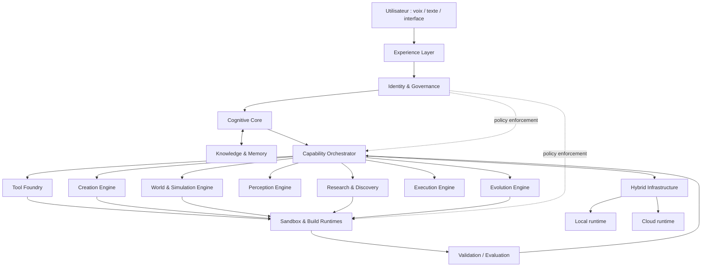

# ARIA SYSTEM BLUEPRINT V1.0
## Architecture cible, contrats inter-systèmes et cartographie de l'existant

**Projet :** ARIA  
**Date :** 3 novembre 2026  
**Statut :** Proposition d'architecture — à arbitrer  
**Branche :** `docs/aria-system-blueprint-v1`  
**Base :** `main`  
**Périmètre :** conception documentaire uniquement. Aucun déploiement, aucune migration et aucune modification de production.

---

## 1. Objet et statut

Ce document traduit la Vision stratégique ARIA V2.0 et le Master Architecture V2.0 en un blueprint technique vérifiable.

Il complète, sans les remplacer :
- `docs/MASTER-SPECIFICATION-ARIA-V1.0.md` (présent sur la branche documentaire `docs/master-specification-aria-v1-0-2026-11-01`, pas confirmé sur `main` au moment de l'inspection) ;
- l'Experience Definition V1.0 validée le 3 novembre 2026, dont la copie canonique dans le dépôt reste à localiser ;
- la Vision stratégique ARIA V2.0 ;
- les spécifications propres à chaque moteur.

**Ce blueprint ne prouve pas que les capacités décrites existent déjà.** Il distingue architecture cible, éléments observés dans le dépôt et travaux restant à démontrer.

## 2. Principes non négociables

1. **Un cerveau, plusieurs capacités :** le Cognitive Core orchestre les moteurs spécialisés ; ceux-ci ne constituent pas des agents souverains.
2. **Contrats explicites :** toute capacité expose un contrat versionné, des permissions, des limites et des résultats structurés.
3. **Sécurité par défaut :** identité et autorisation vérifiées côté serveur ; isolation des comptes et des environnements ; refus en cas de configuration de sécurité manquante.
4. **Autonomie bornée :** exécution autonome dans un périmètre préautorisé ; validation renforcée pour les opérations sensibles.
5. **Évolution réversible :** versions, tests, observabilité, déploiement progressif et rollback.
6. **Hybridation :** traitements locaux et distants selon confidentialité, ressources, latence et disponibilité.
7. **Vérifiabilité :** aucune capacité ne peut être déclarée opérationnelle sans preuve de code et tests reproductibles.
8. **Dépendances assumées :** ARIA peut créer ses propres logiciels, mais reste fondée sur du matériel, des systèmes d'exploitation, des protocoles et des standards. Toute dépendance doit être inventoriée et justifiée.

## 3. Vue d'ensemble

Le schéma représente une cible logique, pas le déploiement actuel.

## 4. Responsabilités et frontières

| Système | Responsabilité | Ne doit pas faire |
|---|---|---|
| Identity & Governance | Identité, rôles, permissions, politiques, audit | Déléguer l'autorisation au client |
| Cognitive Core | Comprendre, raisonner, planifier, arbitrer | Exécuter du code arbitraire directement |
| Knowledge Engine | Recherche, provenance, fiabilité, contradictions | Transformer une hypothèse en fait |
| Memory Engine | Mémoire personnelle, conversationnelle, projet et technique | Mélanger les espaces ou contourner le consentement |
| Capability Orchestrator | Découverte et coordination des capacités | Accorder des privilèges aux moteurs |
| Tool Foundry | Concevoir et construire des outils et runtimes | Déployer ses changements sensibles sans approbation |
| Creation Engine | Créer des artefacts 2D/3D, applications et expériences | Déclarer valide un artefact non testé |
| World & Simulation Engine | Modéliser et simuler des systèmes | Présenter une simulation approximative comme preuve scientifique |
| Perception Engine | Analyser les entrées multimodales autorisées | Collecter des données sans permission |
| Research & Discovery | Hypothèses, expériences, analyse et réplication | Revendiquer une découverte sans validation adaptée |
| Execution Engine | Exécuter les plans autorisés et suivre les tâches | Dépasser le périmètre autorisé |
| Evolution Engine | Évaluer et proposer/améliorer les composants | Modifier librement l'identité, la gouvernance ou les secrets |

Les moteurs peuvent partager des bibliothèques, mais les responsabilités, les données et les privilèges doivent rester séparés.

## 5. Contrat commun d'une capacité

Chaque capacité doit publier un manifeste versionné comprenant au minimum :

- `capability_id`, `version`, `status`, `description` ;
- `input_schema` et `output_schema` ;
- `required_permissions` et `data_scopes` ;
- `resource_limits` : durée, CPU, mémoire, stockage et coût maximal ;
- `execution_mode` : local, cloud ou hybride ;
- `dependencies` et versions compatibles ;
- `side_effects` : fichiers, réseau, données ou appareils concernés ;
- `validation_suite` et critères d'acceptation ;
- `rollback_strategy` et niveau de criticité.

### Enveloppe de tâche

Une tâche orchestrée doit transporter :
- un identifiant unique et un identifiant de corrélation ;
- le compte et l'espace de travail issus du contexte authentifié serveur ;
- l'objectif, les contraintes et les critères de réussite ;
- la capacité et la version sélectionnées ;
- les permissions minimales accordées pour cette tâche ;
- les limites de ressources et l'échéance ;
- l'état, les tentatives et les références d'artefacts ;
- les résultats de validation et les erreurs structurées.

Les identifiants de compte, rôles et permissions fournis dans le corps client ne sont jamais des preuves d'identité ou d'autorisation.

### États normalisés d'une tâche

`queued → planned → authorized → running → validating → succeeded`

États terminaux alternatifs : `failed`, `cancelled`, `blocked`, `expired`.

Une tâche reprenable doit utiliser une clé d'idempotence, conserver son checkpoint et éviter la duplication d'effets de bord lors d'une reprise.

## 6. Flux opérationnel de référence

1. L'Experience Layer transmet une intention au Cognitive Core.
2. Le contexte authentifié et les permissions sont vérifiés.
3. Le Core identifie les objectifs, contraintes et incertitudes.
4. Le Planner décompose le travail et sélectionne des capacités enregistrées.
5. Governance autorise chaque opération selon son périmètre.
6. L'Orchestrator crée des tâches et transmet des enveloppes signées.
7. Les moteurs exécutent dans un runtime isolé.
8. Les artefacts sont stockés avec checksum, provenance et version.
9. Validation exécute les tests fonctionnels, structurels, sécurité et qualité adaptés.
10. Le Core examine les résultats et peut demander une correction bornée.
11. L'utilisateur reçoit le résultat, les limites et les preuves disponibles.
12. Memory enregistre uniquement les éléments autorisés et utiles.

Aucune réponse ne doit affirmer qu'une action a réussi avant confirmation de son résultat.

## 7. Architecture hybride

### 7.1 Plan local
- Interface, audio et interaction appareil ;
- traitement local compatible avec le matériel ;
- cache chiffré et données explicitement autorisées ;
- exécution hors ligne limitée et contrôlée ;
- stockage temporaire des tâches en attente de synchronisation.

### 7.2 Plan cloud
- orchestration persistante ;
- traitements lourds et parallèles ;
- runtimes isolés ;
- stockage d'artefacts ;
- index de connaissances et métadonnées ;
- observabilité et gestion des tâches longues.

### 7.3 Synchronisation
La synchronisation doit être versionnée et résistante aux interruptions. Les conflits ne doivent pas être résolus par écrasement silencieux. Les données sensibles doivent être chiffrées en transit et au repos selon la politique retenue.

### 7.4 Compatibilité avec la base technique
Cloudflare Workers, D1 et stockage objet sont des options déjà présentes ou envisagées dans le projet. Ils ne constituent pas à eux seuls un environnement général d'exécution de code lourd. Les compilations, simulations intensives et traitements multimodaux doivent être évalués sur des runtimes spécialisés.

Supabase Auth apparaît dans le plan de travail comme fournisseur envisagé ; la configuration réelle et son état doivent être confirmés avant de le traiter comme une dépendance active.

## 8. Mémoire et données

Séparer physiquement ou logiquement :
- mémoire personnelle ;
- historique conversationnel ;
- mémoire de projet ;
- connaissances indexées ;
- artefacts ;
- journaux opérationnels ;
- données d'évaluation et de télémétrie.

Chaque objet doit porter propriétaire, espace, classification, provenance, politique de conservation et permissions.

Les journaux techniques ne doivent pas contenir de secrets, jetons, prompts privés complets ou contenus personnels non nécessaires.

Les mécanismes de correction, export et suppression doivent couvrir les index, caches, sauvegardes selon les règles de conservation et données dérivées.

## 9. Sécurité et gouvernance

### 9.1 Zones de confiance
- **Zone A :** client et appareils, considérés non fiables.
- **Zone B :** API et authentification, validation de l'identité.
- **Zone C :** orchestration et gouvernance, services privilégiés.
- **Zone D :** runtimes de tâches, considérés hostiles même lorsqu'ils exécutent du code généré par ARIA.
- **Zone E :** stockage et registre d'artefacts, accès contrôlé et traçable.

### 9.2 Règles
- authentification serveur et autorisation à chaque opération ;
- séparation stricte des comptes et espaces ;
- secrets hors du dépôt et hors des clients ;
- sandbox sans accès réseau par défaut ;
- listes d'accès explicites lorsque le réseau est nécessaire ;
- limites CPU, mémoire, durée, stockage et dépenses ;
- signature ou vérification d'intégrité des artefacts ;
- journal d'audit append-only ou protégé contre l'altération ;
- arrêt d'urgence et révocation des capacités ;
- sauvegarde et restauration testées.

### 9.3 Matrice d'autonomie

| Classe | Exemples | Politique |
|---|---|---|
| A — Faible risque | Analyse, génération dans sandbox, tests, versions de brouillon | Autonomie dans les limites |
| B — Réversible | Optimisation, correction, mise à jour d'un composant non sensible | Tests + déploiement progressif + rollback |
| C — Sensible | Identité, mémoire personnelle, permissions, secrets, réseau privilégié | Approbation explicite |
| D — Critique | Production, dépenses, publication publique, actions physiques ou irréversibles | Autorisation explicite et contrôles renforcés |

L'autonomie continue concerne les classes A et B uniquement, sous réserve des politiques et seuils configurés. Les classes C et D ne sont pas auto-approuvables.

## 10. Evolution Engine : protocole de changement

Chaque amélioration suit un cycle reproductible :

1. Détection d'une limitation à partir de signaux autorisés.
2. Création d'une proposition liée à un objectif mesurable.
3. Construction dans une branche et un environnement isolés.
4. Exécution des tests unitaires, intégration, sécurité et non-régression.
5. Comparaison avec une baseline stable.
6. Revue des permissions, dépendances, coûts et effets de bord.
7. Déploiement progressif uniquement si la classe de risque le permet.
8. Surveillance des métriques et possibilité de rollback.
9. Conservation de la provenance et des résultats.

L'Evolution Engine ne peut pas modifier ses propres règles d'approbation, ses permissions maximales, les secrets ou les mécanismes de sécurité.

## 11. Observabilité et évaluation

Mesurer au minimum :
- taux de réussite des tâches par capacité ;
- taux de correction réussie ;
- régressions introduites ;
- latence et durée d'exécution ;
- coût et consommation de ressources ;
- taux d'échec des synchronisations ;
- incidents d'autorisation ;
- disponibilité des runtimes ;
- reproductibilité des résultats ;
- satisfaction et corrections utilisateur.

Chaque capacité doit disposer d'un jeu d'évaluation représentatif, de seuils de régression et d'une date de dernière validation.

Les performances déclarées doivent être rattachées à un commit, une version, une configuration et un jeu de tests.

## 12. Cartographie de l'existant — dépôt inspecté

**Dépôt :** `Neros31415/-aria-web`  
**Branche de référence inspectée :** `main`  
**Date d'inspection :** 3 novembre 2026.

### 12.1 Faits vérifiés sur main
- Le README décrit une base reconstruite ARIA Web V0.7, interface responsive/PWA, historique local et notes mémoire locales.
- Le README indique explicitement que le vrai modèle IA, la recherche Web, la synchronisation iPhone-PC, le contrôle Windows, l'authentification, le backend et les paiements ne sont pas connectés dans cette base.
- `app.js` utilise `localStorage` pour les messages et notes, et `localReply()` fournit des réponses locales prédéfinies.
- `index.html` expose l'état prototype et indique qu'aucune action sur le téléphone ou le PC n'est exécutée.
- Le dépôt contient `docs/STAGING-DEPLOYMENT-PARITY-AUDIT.md` et `docs/PLAN-EXECUTION-TRACEABILITE-V1.md`.

### 12.2 Éléments documentés hors de main
Une branche nommée `docs/master-specification-aria-v1-0-2026-11-01` contient `docs/MASTER-SPECIFICATION-ARIA-V1.0.md`. Cette branche documentaire n'est pas la branche principale et son contenu doit être comparé avant toute consolidation.

### 12.3 Staging — preuve documentaire, pas nouvelle vérification runtime
L'audit daté du 22 octobre 2026 décrit un Worker Cloudflare `aria-brain-staging`, une liaison D1 `aria-authz-staging`, un mode session KV et un lot CI documenté comme réussi. Le même audit précise que le test HTTP direct de `/health` n'a pas pu être exécuté depuis l'environnement d'outillage et liste des bloqueurs avant production.

Ces informations sont des preuves documentaires datées. Elles ne prouvent pas l'état actuel du Worker au 3 novembre 2026.

### 12.4 Conclusion de cartographie
La base `main` inspectée est un prototype PWA local, et non l'implémentation de la plateforme autonome décrite dans ce blueprint. Les travaux backend et staging sont présents dans la documentation et certaines branches, mais leur intégration et leur état actuel doivent être audités séparément.

Aucune capacité Tool Foundry, Creation Engine universel, World Engine généraliste ou Evolution Engine n'a été démontrée dans les fichiers `main` inspectés.

## 13. Écarts prioritaires

| ID | Écart | Priorité | Preuve de clôture |
|---|---|---:|---|
| GAP-01 | Consolider la source normative : Master Specification, Experience Definition et Vision | P0 | Versions canoniques identifiées et conflits arbitrés |
| GAP-02 | Réconcilier les branches et PR ouvertes sans intégrer aveuglément | P0 | Matrice commit/branche/PR/tests |
| GAP-03 | Vérifier l'authentification et l'autorisation en staging | P0 | Tests HTTP authentifiés et négatifs, panne D1, isolation multi-comptes |
| GAP-04 | Définir les contrats Core ↔ Orchestrator ↔ capacités | P1 | Schémas versionnés et tests de contrat |
| GAP-05 | Définir l'exécution isolée | P1 | Threat model, sandbox, limites et tests d'évasion |
| GAP-06 | Définir mémoire projet et registre d'artefacts | P1 | Schéma, ACL, rétention, export et suppression testés |
| GAP-07 | Définir tâches durables et reprise idempotente | P1 | Tests de crash/reprise/annulation |
| GAP-08 | Définir le plan local/cloud et la synchronisation | P1 | ADR, tests hors ligne et conflits |
| GAP-09 | Définir évaluation et évolution contrôlée | P2 | Baselines, seuils, rollout et rollback démontrés |
| GAP-10 | Construire les moteurs spécialisés par incréments | P2 | Démonstrations fonctionnelles par domaine |

## 14. Décisions d'architecture à formaliser (ADR)

Les décisions suivantes restent ouvertes et doivent être enregistrées individuellement :

- ADR-001 : fournisseur(s) de modèles et stratégie d'abstraction ;
- ADR-002 : identité, fournisseur Auth et provisionnement administrateur ;
- ADR-003 : stockage relationnel, objet, index et chiffrement ;
- ADR-004 : protocole de tâches, files, reprise et idempotence ;
- ADR-005 : technologie et isolation des runtimes ;
- ADR-006 : registre de capacités et découverte ;
- ADR-007 : synchronisation locale/cloud et résolution de conflits ;
- ADR-008 : observabilité, audit et conservation ;
- ADR-009 : pipeline d'évolution, approbation et rollback ;
- ADR-010 : budgets, quotas et contrôle des coûts.

Aucun choix technologique ne doit être figé avant analyse des exigences, du coût, des risques et des contraintes de déploiement.

## 15. Plan d'exécution recommandé

### Lot 0 — Réconciliation documentaire
- identifier les versions canoniques ;
- comparer les branches documentaires ;
- résoudre les contradictions ;
- publier une matrice de traçabilité.

### Lot 1 — Audit technique actuel
- inspecter main, branches actives, PR et CI ;
- inspecter staging sans exposer de secrets ;
- confirmer l'authentification, l'autorisation, la mémoire et les migrations ;
- établir un état réel daté.

### Lot 2 — Fondations de confiance
- identité ;
- permissions ;
- séparation multi-comptes ;
- mémoire ;
- audit ;
- gestion des secrets.

### Lot 3 — Orchestration durable
- contrats de capacité ;
- planification ;
- tâches asynchrones ;
- idempotence ;
- reprise et annulation.

### Lot 4 — Runtime isolé
- sandbox ;
- quotas ;
- politiques réseau ;
- artefacts ;
- tests de sécurité.

### Lot 5 — Première capacité de bout en bout
Choisir un cas d'usage étroit et mesurable, par exemple générer un petit outil Web, le tester dans une sandbox, conserver ses versions et le modifier par instruction naturelle.

### Lot 6 — Extension progressive
Ajouter ensuite création 2D/3D, simulation, recherche et évolution contrôlée, une capacité après l'autre.

**Aucun déploiement production, merge vers main, migration destructive ou changement de secrets n'est autorisé par ce document.**

## 16. Critères d'acceptation du Blueprint

Le blueprint sera prêt à guider l'implémentation lorsque :
- les documents normatifs sont réconciliés ;
- chaque système a un propriétaire architectural ;
- chaque interface possède un contrat versionné ;
- les frontières de confiance sont documentées ;
- la matrice d'autonomie est approuvée ;
- le modèle hybride est spécifié ;
- les écarts reposent sur un audit daté ;
- les critères de test sont mesurables ;
- les décisions technologiques sont enregistrées en ADR.

---

## Conclusion

ARIA doit être construite comme une plateforme cohérente, pas comme une juxtaposition de fonctionnalités.

Le Cognitive Core comprend et orchestre. Les moteurs spécialisés créent et exécutent. Governance contrôle. Knowledge et Memory assurent la continuité. Validation établit les preuves. Evolution améliore le système dans un périmètre contrôlé.

La cible est extensible au-delà des outils existants, mais chaque nouvelle capacité doit être construite, testée, sécurisée et démontrée.

**ARIA — Beyond what exists.**
