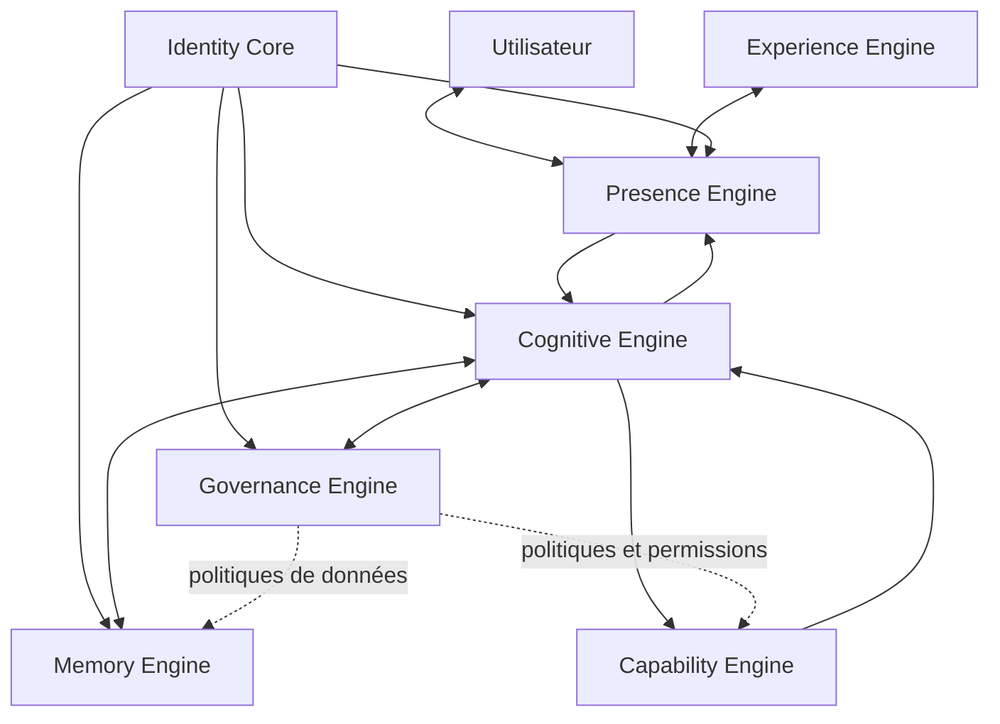

# ARIA — SYSTEM BLUEPRINT V1.1
## Architecture logique, contrats et cartographie de l'existant

**Date :** 3 novembre 2026  
**Statut :** Draft corrigé — non canonique, en attente d'arbitrage  
**Branche :** `architecture/master-architecture-v2-draft`  
**Référence d'architecture :** `docs/ARIA-MASTER-ARCHITECTURE-V2.0-DRAFT.md`  
**Historique :** corrige les écarts identifiés dans `docs/ARIA-COHERENCE-AUDIT-2026-11-03.md`. Le document V1.0 est conservé comme historique et n'est pas silencieusement réécrit.  
**Périmètre :** conception documentaire uniquement.

> Les versions canoniques complètes de la Vision stratégique V2.0 et de la Master Architecture V2.0 d'origine n'ont pas été localisées lors de l'audit. Cette V1.1 est alignée sur les décisions connues et sur le draft de Master Architecture créé dans cette branche ; elle ne prétend pas remplacer des sources originales non consultées.

---

## 1. Objet et statut

Ce blueprint décrit comment les sept systèmes directeurs d'ARIA coopèrent, quels contrats ils exposent et comment les capacités sont exécutées et vérifiées. Il distingue systématiquement :
- **décidé** : décision utilisateur explicitement validée ;
- **cible** : comportement architectural attendu ;
- **proposé** : détail technique encore à arbitrer ;
- **observé** : élément attesté dans un dépôt, une branche ou un rapport daté ;
- **validé** : comportement démontré par des tests adaptés dans l'environnement concerné.

Il complète le Master Specification V1.0 et l'Experience Definition V1.0 ; il ne les remplace pas. L'Experience Definition V1.0 est une référence conceptuelle validée et complémentaire au Master Specification.

## 2. Principes directeurs

1. Sept systèmes directeurs, pas une juxtaposition de moteurs souverains.
2. Identité, présence, cognition, mémoire, gouvernance, capacités et expérience ont des frontières distinctes.
3. Identity Core fournit le contexte d'identité ; Governance Engine décide des autorisations.
4. Cognitive Engine planifie et orchestre ; Capability Engine exécute.
5. Memory Engine fournit une mémoire riche, multicouche, traçable et contrôlée.
6. L'autonomie validée est un principe de conception ; ses seuils, budgets et règles de fréquence restent à formaliser.
7. Voix prioritaire, interruption immédiate et états d'interaction réels.
8. Clients iPhone, Web et PC cohérents, mais soumis à leurs permissions et capacités propres.
9. Toute capacité expose contrat, permissions, limites, dépendances et preuves.
10. Aucune capacité n'est déclarée opérationnelle sans tests et preuves datées.

## 3. Architecture logique

Boucle directrice : **Presence → Cognitive → Memory/Governance → Capability → Cognitive → Presence**.  
Relation d'expérience : **Experience Engine ↔ Presence Engine**.

Les échanges peuvent être synchrones ou asynchrones selon les contrats ; le schéma n'impose pas une topologie réseau.

## 4. Responsabilités et frontières

| Système | Responsabilité | Interdiction structurante |
|---|---|---|
| **Identity Core** | Identité fondamentale d'ARIA, identité authentifiée de l'utilisateur, comptes, espaces et contexte | Ne s'accorde pas le pouvoir d'autoriser les actions |
| **Presence Engine** | Interaction temps réel, états vocaux, écoute, parole, interruption, pause, reprise et continuité | Ne prétend jamais écouter ou parler si le dispositif ne le fait pas |
| **Cognitive Engine** | Compréhension, contexte, raisonnement, planification, arbitrage et orchestration | Ne contourne pas Governance et n'exécute pas directement du code arbitraire |
| **Memory Engine** | Mémoire riche multicouche, historique, préférences, projets, tâches, décisions et provenance | Ne mélange pas les comptes et ne contourne pas les droits utilisateur |
| **Governance Engine** | Permissions, consentement, politiques, risques, approbations, quotas, audit, révocation et limites d'autonomie | Ne délègue jamais l'autorisation au client ou au modèle |
| **Capability Engine** | Registre, découverte, exécution, validation et cycle de vie des capacités | Une capacité ne peut pas élever ses propres privilèges |
| **Experience Engine** | Personnalité, profils, expression, HUD, visualisations, immersion et cohérence des clients | Ne masque pas les limites réelles d'une plateforme |

### Placement des moteurs spécialisés

Les concepts ci-dessous sont des sous-systèmes, familles de capacités ou processus internes de Capability Engine, et non des systèmes racine additionnels :
- **Tool Foundry** : conception, génération, maintenance et empaquetage d'outils.
- **Creation** : création logicielle, documentaire, graphique et 2D/3D.
- **Perception** : analyse multimodale des entrées autorisées.
- **Research & Discovery** : recherche, hypothèses, analyse et expérimentation avec provenance.
- **World & Simulation** : modélisation et simulation spécialisées, avec hypothèses et validation.
- **Execution Runtime** : exécution isolée des tâches et gestion des effets de bord.
- **Evolution contrôlée** : proposition, test, évaluation et évolution autorisée ; ne peut pas modifier les règles qui la gouvernent.
- **Knowledge** : fonctions transversales de recherche, provenance et qualité de l'information, articulées avec Cognitive et Memory ; pas un huitième système directeur.

## 5. Contrats inter-systèmes

Les contrats suivants sont des interfaces logiques proposées ; les schémas définitifs doivent être versionnés et validés par ADR.

| Contrat | Émetteur → consommateur | Données principales |
|---|---|---|
| `IdentityContext` | Identity Core → Presence, Cognitive, Memory, Governance | sujet authentifié, compte, espace, session, niveau d'assurance |
| `PresenceEvent` | Presence → Cognitive / Experience | état réel, canal, événement de tour, interruption |
| `CognitivePlan` | Cognitive → Governance / Capability | objectif, étapes, contraintes, critères de réussite |
| `MemoryQuery / MemoryWrite` | Cognitive ↔ Memory | requête, scopes, provenance, finalité |
| `PolicyDecision` | Governance → Cognitive / Capability / Memory | allow, deny, require_approval, defer, revoke et conditions |
| `CapabilityManifest` | Capability → Cognitive / Governance | version, schémas, permissions, ressources, effets de bord |
| `CapabilityTask` | Cognitive → Capability | plan autorisé, identifiants, limites et échéance |
| `CapabilityResult` | Capability → Cognitive | résultat, erreurs, artefacts, validations et preuves |
| `ExperienceDirective` | Cognitive / Presence → Experience | forme de restitution, canal, profil et état |
| `AuditEvent` | systèmes concernés → Governance / audit | décision, acteur, action, résultat, corrélation |

### Manifeste minimal d'une capacité

`capability_id`, `version`, `status`, description, schémas d'entrée/sortie, permissions requises, scopes de données, effets de bord, runtime, mode local/cloud/hybride, dépendances, limites de ressources, coût maximal, suite de validation et stratégie d'annulation/rollback.

### Enveloppe de tâche

Toute tâche porte un identifiant unique, un identifiant de corrélation, le compte et l'espace issus du contexte serveur, l'objectif, les contraintes, les critères de réussite, la capacité/version, les permissions minimales, les limites, l'échéance, l'état, les tentatives, les checkpoints, les références d'artefacts et les résultats de validation. Les champs d'identité fournis librement par le client ne font pas autorité.

États : `queued → planned → authorized → running → validating → succeeded`.  
États terminaux alternatifs : `failed`, `cancelled`, `blocked`, `expired`.

Les tâches reprenables doivent être idempotentes et empêcher la répétition involontaire des effets de bord.

## 6. Flux opérationnel

### Interaction
1. Presence reçoit une entrée et publie l'état réel.
2. Cognitive interprète l'intention et les contraintes.
3. Identity fournit le contexte authentifié.
4. Cognitive consulte Memory selon les droits.
5. Cognitive formule une réponse ou un plan.
6. Experience prépare la restitution.
7. Presence restitue la réponse et gère interruption/reprise.

### Exécution d'une capacité
1. Cognitive construit un plan.
2. Capability sélectionne une capacité enregistrée.
3. Governance vérifie identité, permissions, risque, portée et limites.
4. Une approbation explicite est recueillie si nécessaire.
5. Capability exécute dans un runtime isolé.
6. Les résultats et effets de bord sont validés.
7. Cognitive examine les preuves et décide de poursuivre, corriger ou arrêter.
8. Experience/Presence présentent le résultat et ses limites.
9. Memory conserve uniquement les éléments autorisés.

Aucune action ne peut être annoncée comme réussie avant confirmation de son résultat.

## 7. Mémoire riche et données

Familles à distinguer : mémoire personnelle, préférences, mémoire conversationnelle, mémoire de projet, mémoire de tâches, mémoire de décisions, connaissances indexées et mémoire épisodique.

Chaque objet doit porter propriétaire, compte/espace, catégorie, classification, provenance, dates, statut, finalité, politique de conservation et permissions de lecture/écriture/partage/export/suppression.

Cycle cible : capture autorisée → qualification → proposition/consentement → indexation → récupération filtrée → correction/expiration/export/suppression → propagation aux index et données dérivées selon la politique de rétention.

Les journaux ne doivent pas exposer de secrets, jetons, prompts privés complets ou données personnelles non nécessaires. Les garanties de suppression doivent préciser le traitement des sauvegardes et copies dérivées ; ne pas promettre une purge instantanée non vérifiée.

## 8. Présence et expérience

- La voix est le canal principal ; le texte est complémentaire et sert de secours/consultation.
- L'écoute n'est jamais cachée ; les états du microphone sont compréhensibles.
- L'utilisateur peut interrompre immédiatement ARIA, arrêter ou mettre en pause l'écoute.
- Les états visuels représentent l'état réel, et non une animation fictive.
- L'onboarding est conversationnel ; préférences et consentement mémoire sont recueillis distinctement.
- Le HUD est discret, borderless, chaleureux, minimaliste et contextuel.
- La personnalité est élégante, vive et complice ; ARIA tutoie l'utilisateur.
- Le logo A triangulaire peut ouvrir une transition immersive vers une visualisation et permettre le retour sans perte de contexte.
- Les visualisations distinguent rendu visuel, modèle manipulable, simulation, données simulées et données réelles.

Les arbitrages encore ouverts D-004 à D-007 ne sont pas déclarés validés par ce blueprint.

## 9. Clients et architecture hybride

**iPhone :** expérience native, audio, permissions, notifications et tâches en arrière-plan selon iOS ; cache local chiffré si retenu.  
**Web :** expérience navigateur avec permissions limitées au navigateur ; aucun accès implicite aux fichiers ou au système.  
**PC :** capacités locales via un agent installé, authentifié et explicitement autorisé ; permissions par fonction, visibilité et arrêt d'urgence.

Les capacités doivent être négociées par client et vérifiées au moment de l'opération. Aucun client n'hérite des permissions d'un autre.

**Plan local :** capture/restitution audio, interaction native autorisée, traitements compatibles, cache chiffré, tâches hors ligne limitées.  
**Plan cloud :** orchestration persistante, traitements lourds, stockage d'artefacts, index, runtimes isolés et observabilité.

Cloudflare Workers/D1 peuvent assurer API, orchestration légère, autorisation et stockage relationnel selon limites vérifiées ; ils ne sont pas présumés être un runtime général de compilation ou de simulation lourde. Tout fournisseur d'authentification envisagé doit être confirmé par configuration et preuves avant d'être qualifié d'actif.

La synchronisation doit être versionnée, chiffrée, résistante aux interruptions, idempotente et sans écrasement silencieux des conflits.

## 10. Gouvernance, sécurité et autonomie

Zones de confiance :
- A — clients/appareils : non fiables ;
- B — API/authentification : frontière d'entrée ;
- C — Cognitive/Governance/orchestration : services contrôlés ;
- D — runtimes de capacités : potentiellement hostiles ;
- E — mémoire/artefacts : accès strictement contrôlé.

Exigences minimales : authentification et autorisation serveur, isolation multi-comptes, moindre privilège, secrets hors dépôt/clients, sandbox sans réseau par défaut, allowlist si nécessaire, quotas CPU/mémoire/durée/stockage/coût, intégrité des artefacts, audit protégé, arrêt d'urgence, révocation, sauvegarde et restauration testées.

**Autonomie :** D-003 valide le principe du partenaire autonome, pas les seuils d'exécution. Le modèle de risque doit considérer impact, réversibilité, portée, sensibilité, coût, fréquence, confiance et permissions préautorisées. La matrice A/B/C/D de V1.0 est une proposition historique non validée et ne doit pas être appliquée comme règle.

## 11. Évolution contrôlée

Le processus d'évolution relève de Capability Engine et suit : signal autorisé → proposition mesurable → branche/runtime isolé → tests → comparaison à une baseline → revue sécurité/coûts/permissions → approbation selon risque → déploiement autorisé → surveillance → rollback si nécessaire.

Le processus ne peut pas modifier ses propres règles d'approbation, permissions maximales, secrets ou mécanismes de sécurité.

## 12. Observabilité et statut des preuves

Chaque système/capacité publie version, commit, statut, tests, date d'exécution, métriques, coût, dépendances, limites et preuves.

Statuts à employer sans les confondre : proposé, prototypé, implémenté, testé, validé, déployé. Les tests unitaires seuls ne prouvent pas le comportement de bout en bout.

Mesures minimales : réussite, erreurs, corrections, régressions, latence, coût, synchronisation, incidents d'autorisation, disponibilité, reproductibilité et retours utilisateur.

## 13. Cartographie de l'existant — constat documentaire daté

Les audits disponibles au 3 novembre décrivent `main` comme une PWA prototype V0.7 avec historique et notes locales. Le modèle IA réel, l'authentification complète, la mémoire persistante multi-comptes, la synchronisation iPhone-PC et les actions Windows ne sont pas démontrés comme intégrés sur `main`.

Les branches et PR spécialisées sur la voix, l'authentification, D1, l'autorisation et d'autres fonctions ne valent pas intégration. Le Master Specification du 1er novembre rapporte notamment un Worker staging version 26, un mode `session_kv`, un garde-fou d'authentification individuelle incomplet sur certaines routes et l'absence de preuve HTTP E2E avec deux comptes canoniques. Ces constats sont documentaires et datés ; ils ne constituent pas une nouvelle vérification runtime au 3 novembre.

Le présent blueprint ne certifie aucun service ni aucune capacité. Une nouvelle revue technique doit établir l'état courant avant implémentation ou intégration.

## 14. Écarts et ordre de réalisation

| ID | Écart | Priorité | Preuve de clôture |
|---|---|---:|---|
| GAP-01 | Canonicaliser Vision V2.0, Master Architecture V2.0 et Experience Definition | P0 | Sources/version/statuts identifiés et hiérarchie arbitrée |
| GAP-02 | Réconcilier branches et PR | P0 | Matrice bases/commits/PR/CI/tests |
| GAP-03 | Prouver auth, autorisation et isolation staging | P0 | Tests HTTP positifs/négatifs avec deux comptes et pannes contrôlées |
| GAP-04 | Versionner les contrats des sept systèmes | P1 | Schémas et tests de contrat |
| GAP-05 | Définir runtime et isolation | P1 | Threat model, quotas, politiques réseau et tests |
| GAP-06 | Formaliser mémoire riche et cycle de vie | P1 | Schéma, ACL, consentement, rétention, export/suppression testés |
| GAP-07 | Tâches durables et reprise | P1 | Tests crash/reprise/annulation/idempotence |
| GAP-08 | Contrats iPhone/Web/PC et synchronisation | P1 | ADR et tests par client/conflits |
| GAP-09 | Évaluation et évolution contrôlée | P2 | Baselines, seuils, approbation et rollback démontrés |
| GAP-10 | Construire les capacités par incréments | P2 | Démonstrations end-to-end par capacité |

Ordre recommandé : canonicalisation documentaire → fondations identité/gouvernance/mémoire → présence/expérience → cognition/orchestration → première capacité isolée de bout en bout → extension progressive → évolution gouvernée.

Les concepts réservés (OS cognitif général, monde miroir universel, moteur causal général, mondes parallèles, laboratoire général d'auto-amélioration) restent hors périmètre immédiat.

## 15. Conditions de validation

Le Blueprint ne devient référence approuvée que lorsque :
- les sources normatives canoniques sont localisées ou leur absence arbitrée ;
- les sept systèmes et leurs frontières sont approuvés ;
- les contrats sont versionnés et testés ;
- les politiques mémoire/autonomie/multiplateforme sont décidées ;
- les ADR nécessaires sont validés ;
- les exigences ont une traçabilité vers des tests et preuves ;
- la cartographie du code et des services est réactualisée.

**Aucun merge vers `main`, déploiement, migration, changement de configuration, lecture de secrets ou modification de production n'est autorisé par ce document.**

**ARIA — Beyond what exists.**
